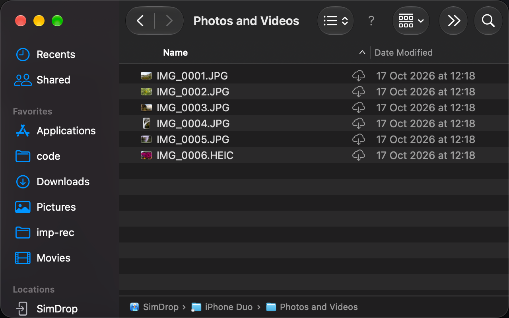

# SimDrop

Shows running iOS simulators in the Finder sidebar so you can drag files in and out of them.



```
SimDrop                      ← Finder sidebar › Locations
└── iPhone Duo/              ← one folder per *booted* simulator
    ├── Photos and Videos/   ← simulator Photos library
    └── Downloads/           ← Files app › On My iPhone › Downloads
```

Simulators appear when they boot and disappear when they shut down (duplicate names are
disambiguated by runtime). Everything is also reachable from the terminal:

```sh
cp config.json ~/Library/CloudStorage/SimDrop-SimDrop/iPhone\ Duo/Downloads/
```

## Install

```sh
brew install --cask rxliuli/tap/sim-drop
```

Or download `SimDrop-macos.dmg` from
[GitHub Releases](https://github.com/rxliuli/sim-drop/releases). Requires macOS 15 or
later. It is Developer ID signed and notarized. SimDrop isn't on the Mac App Store and
can't be: the app and its helper must run unsandboxed to drive `simctl` and the
simulators' folders.

## Setup

Open SimDrop once. The window is a settings page showing status for:

1. **Background Service** (required): allow SimDrop in System Settings › General › Login
   Items.
2. **Finder Extension** (required): click **Enable** in the Finder banner (or turn on
   SimDrop under File Providers in System Settings).
3. **Notifications** (optional): notifies you when a non-media file dropped into
   `Photos and Videos` is redirected to `Downloads`.

After that it works silently in the background, including after a restart, and the window
can be closed.

**After installing or upgrading, open SimDrop once.** Replacing the app makes macOS drop
its Finder extension and stop the background helper until the new version has been
launched (see *Upgrades* under Architecture for details).

## Behavior to know about

### Dragging in moves by default; dragging out copies

Finder moves files when you drag within the same volume and copies only across volumes.
File Provider locations live in `~/Library/CloudStorage` on your startup disk, so
**dragging a file from the Desktop into SimDrop moves it**. iCloud Drive and Google Drive
behave the same way, and File Provider has no API to change this.

- Hold **⌥ Option** while dragging **into** SimDrop to copy instead.
- Dragging **out of** SimDrop (from either `Photos and Videos` or `Downloads`) **copies
  by default**, because items don't expose `allowsReparenting`. To remove a file from the
  simulator, delete it in Finder (**Move to Trash** / `⌘⌫`).

Making drops into SimDrop copy by default like a USB drive would require it to be a
separate volume (e.g. an FSKit file system), which would be a rewrite.

### Photos and Videos

- Images show previews in Finder without materializing the full files first (the
  extension generates downscaled JPEG thumbnails).
- Dropped images and videos are imported with `simctl addmedia`, so they show up in the
  Photos app. iOS renames them (e.g. `IMG_0007.JPG`), and Finder updates the name to
  match.
- Finder can't reject drops by file type, so **anything that isn't an image or video is
  saved in the same simulator's `Downloads` folder instead**. Finder moves it there too.
- When that happens SimDrop posts a notification saying where the file went (rapid drops
  are grouped per simulator). Known issue: clicking the notification doesn't open Finder
  yet.
- Photos can't be edited or renamed in place from Finder. The list mirrors the Photos
  library read from `Photos.sqlite` (falling back to DCIM if unreadable), so photos
  deleted in the simulator disappear from Finder too.
- **Deleting a photo in Finder moves it to the simulator's "Recently Deleted"**
  (recoverable there for 30 days), with no confirmation dialog. If the Photos app is open
  in the simulator, SimDrop relaunches it so the change shows.

### Downloads

- Supports adding, opening, replacing, and deleting files and folders.
- **Deleting goes to the Mac's Trash**, with no confirmation dialog. The file is removed
  from the simulator and lands in your Trash. **Put Back** restores it into the
  simulator.
- Renaming and moving items inside `Downloads` isn't supported yet, because item
  identifiers are path-based.
- Changes made inside the simulator appear in Finder within a couple of seconds.

### Scope

- iOS simulators only. watchOS, tvOS, and visionOS simulators aren't listed, and physical
  devices aren't supported: iOS doesn't expose the Files app storage over USB, and photos
  written to a real device's DCIM folder are not imported into its Photos library.

## Architecture

| Target | Sandbox | Role |
|---|---|---|
| `SimDrop` (app) | no | Settings window and headless `-setupOnly` mode. Registers the helper (`SMAppService.agent`) and the single File Provider domain. |
| `SimDropHelper` (launchd agent) | no | Starts at login. Watches `~/Library/Developer/CoreSimulator/Devices` with FSEvents and calls `signalEnumerator` to refresh Finder. Over XPC (team-ID verified) it runs `xcrun simctl addmedia`, updates `Photos.sqlite` to trash photos, and moves deleted `Downloads` files to the Mac's Trash. Exits when replaced on disk (`UpgradeWatcher`) so `launchd` starts the new binary. Must be a plain tool in `SimDrop.app/Contents/MacOS`—as a separate `.app` bundle, `signalEnumerator` fails with "The application cannot be used right now". |
| `SimDropFileProvider` (extension) | yes | `NSFileProviderReplicatedExtension`. Reads and writes simulator folders directly through a temporary-exception entitlement, serves image thumbnails, posts redirect notifications, calls the helper over XPC for imports/deletes, and auto-launches `SimDrop.app -setupOnly YES` (`HelperRepair`) if the helper becomes unreachable. |
| `Shared/` | — | Simulator discovery from `device.plist` (`state == 3`, `iOS` runtimes), duplicate-name disambiguation, and path resolution. |

Paths inside a simulator (`~/Library/Developer/CoreSimulator/Devices/<UDID>/`):

- Downloads: `data/Containers/Shared/AppGroup/<UUID>/File Provider Storage/Downloads`,
  where the group's metadata plist has
  `MCMMetadataIdentifier = group.com.apple.FileProvider.LocalStorage`.
- Photos: `data/Media/DCIM/1xxAPPLE/`. Library state comes from
  `data/Media/PhotoData/Photos.sqlite` (`ZASSET`, where `ZTRASHEDSTATE = 0`).

Implementation notes:

- **Upgrades.** Replacing `SimDrop.app` makes macOS drop the Finder extension (Finder
  then says the application can't be found) and stop the background helper: `launchd`
  refuses to start a helper whose recorded launch constraint came from the old copy
  (`needs LWCR update`, exit 78). A Homebrew `postflight_steps` can't launch the app
  either, because `open` fails inside the cask step sandbox, so the cask shows a caveat
  instead. Opening the app re-registers the extension and checks the helper's version,
  booting out the stale `launchd` job and re-registering if needed. While the extension
  is running, `HelperRepair` can also launch `SimDrop.app -setupOnly YES` headlessly if
  the helper stops answering.
- **Change sync.** The helper calls `signalEnumerator(.workingSet)`. The working-set
  enumerator diffs against the last snapshot it handed out (stored in the extension's
  container) and reports removed items with `didDeleteItems`. Leaving an item out of the
  working set does not remove it from Finder.
- **Deleting photos.** The helper edits `Photos.sqlite` directly. It updates the same
  `ZASSET` columns an in-app delete changes (`ZTRASHEDSTATE`, `ZTRASHEDREASON`,
  `ZTRASHEDDATE`, `ZMODIFICATIONDATE`, `Z_OPT`), found by diffing the table before and
  after deleting in the Photos app. The tables have Core Data triggers calling
  `NSCoreDataTriggerUpdateAffectedObjectValue`, which only exists inside the Photos
  daemon, so the helper registers a no-op function with that name. The Photos app caches
  the library and only shows the change after a relaunch. This is unofficial: a future
  iOS schema change may break it, and the helper then reports an error instead of
  guessing.
- **Thumbnails.** Image previews are served through `NSFileProviderThumbnailing` via
  `ImageIO` (`CGImageSource`). Finder only asks File Providers for thumbnails of media
  types, never for `.app`, `.ipa`, or `.zip` (an app-install feature was tried and
  removed for now). Thumbnails are cached per content version, so bump
  `Item.contentSchema` after changing them.
- **Re-imports.** After the domain reconnects (e.g. following an upgrade), the system may
  call `createItem` for folders or files it already had, including items under a
  simulator that has since shut down. These are adopted under their real identifiers. A
  rejected create stays pending forever, and the system ignores deletions of a pending
  item, so a shut-down simulator would never disappear.
- **Folder types.** Directories are always reported as `public.folder`, including bundles
  like `.app`. For uploads, the returned type must match the template, or the system
  keeps retrying the create and never uploads the children.
- **Item versions.** `Item.metadataSchema` is part of every metadata version. Bump it
  when capabilities change, or Finder keeps the cached ones (e.g. photos showing as
  "locked").
- **Trash.** The domain keeps the default `supportsSyncingTrash = YES`, so Finder
  reparents trashed items to `.trashContainer`. `modifyItem` (and `deleteItem` on
  immediate deletes) routes `Downloads` items to the Mac's Trash and photos to the
  simulator's "Recently Deleted" through the helper, and the next sync reports the item
  as deleted. The extension must serve `.trashContainer` (an empty folder); otherwise the
  domain's `.Trash` becomes a stale handle and Finder fails with -36.

## Release

CI (`.github/workflows/release.yml`) runs when `MARKETING_VERSION` in `project.yml`
changes on `main`. It generates the project with XcodeGen, then uses
[`rxliuli/apple-release/dmg`](https://github.com/rxliuli/apple-release) to archive, sign
with Developer ID, build the DMG, notarize, staple, and publish a GitHub Release. The
`release-macOS` environment needs these secrets: `APPLE_CERTIFICATE_DEVELOPERID_BASE64`,
`APPLE_CERTIFICATE_DEVELOPERID_PASSWORD`, `APPLE_API_KEY`, `APPLE_API_KEY_ID`,
`APPLE_API_ISSUER`, and optionally `TAP_GITHUB_TOKEN`. When it is set, the release also
bumps `Casks/sim-drop.rb` in `rxliuli/homebrew-tap`.

No provisioning profile is involved. The app group is Team-ID-prefixed
(`N2X78TUUFG.com.rxliuli.sim-drop`, not `group.…`), which macOS accepts without one.

## Build

Requires [XcodeGen](https://github.com/yonaskolb/XcodeGen).

```sh
xcodegen generate
xcodebuild -project SimDrop.xcodeproj -scheme SimDrop -derivedDataPath build \
  -allowProvisioningUpdates build
# restart the extension and helper so they pick up the new build
pkill -x SimDropFileProvider; launchctl kickstart -k gui/$(id -u)/com.rxliuli.sim-drop.helper
open build/Build/Products/Debug/SimDrop.app
```

App icon: the source is `Design/icon-source.png` (a full-bleed 1024 squircle with
transparent corners). Regenerate the icon set with
`swift Design/make-icon.swift Design/icon-source.png SimDrop/Assets.xcassets/AppIcon.appiconset`.
The script scales the artwork to the 824pt macOS icon grid and adds a drop shadow.

Dev launch flags:

- `open SimDrop.app --args -setupOnly YES` ensures the helper and File Provider domain
  are registered and quits without showing a window.
- `open SimDrop.app --args -reregisterHelper YES` re-registers the launchd agent after its
  plist changes.
- `open SimDrop.app --args -resetDomain YES` removes the domain with all local state and
  re-adds it.

Don't remove the helper's launchd job on a plain uninstall (e.g. `uninstall launchctl:`
in the cask). `brew upgrade` runs the old version's uninstall step before installing the
new one, so the job disappears while the registration still says "enabled". The cask only
does this on `--zap`.

Switching between a dev build and an installed release: only one copy should be
registered. `launchd` records a launch constraint (LWCR) for the helper with the signing
identity of whichever copy registered it. If that copy differs from the one now on disk
(e.g. Apple Development vs Developer ID), `launchd` refuses to start the helper
(`last exit reason = OS_REASON_CODESIGNING`). Quit the other copy, then run
`launchctl bootout gui/$(id -u)/com.rxliuli.sim-drop.helper` and launch the copy you want
with `--args -reregisterHelper YES`. Duplicate extensions (`pluginkit -m -v -D -i
com.rxliuli.sim-drop.FileProvider`) also hide SimDrop from System Settings › Login Items
& Extensions.

Logs: `log stream --predicate 'subsystem == "com.rxliuli.sim-drop"'`

## License

[GPL-3.0](./LICENSE)
